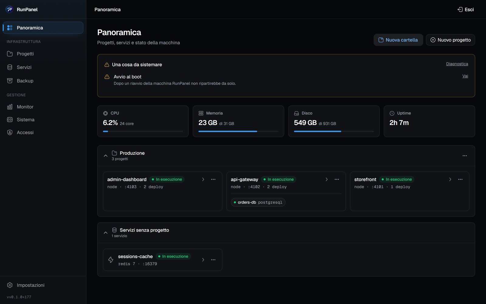
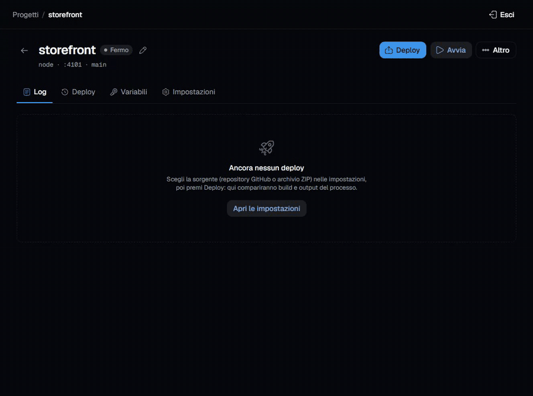
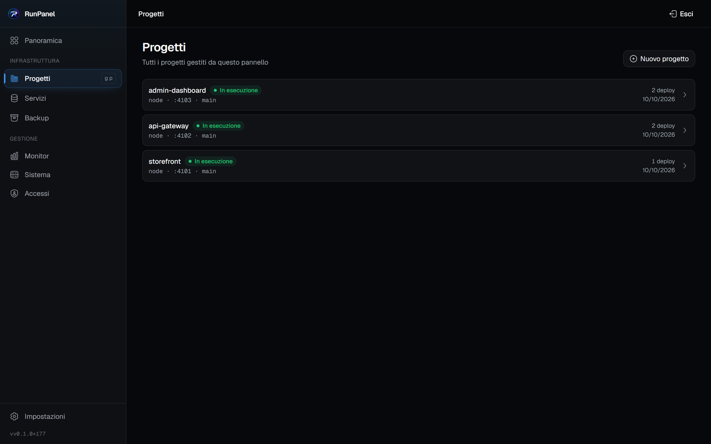
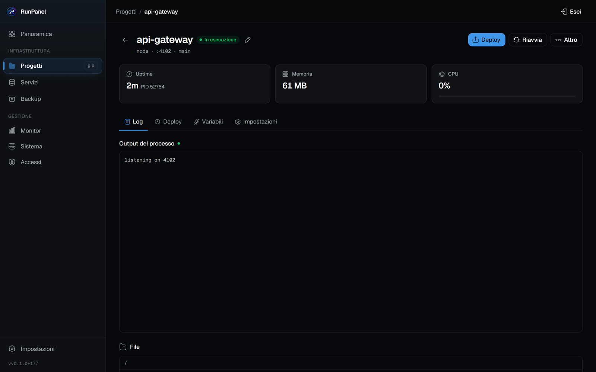
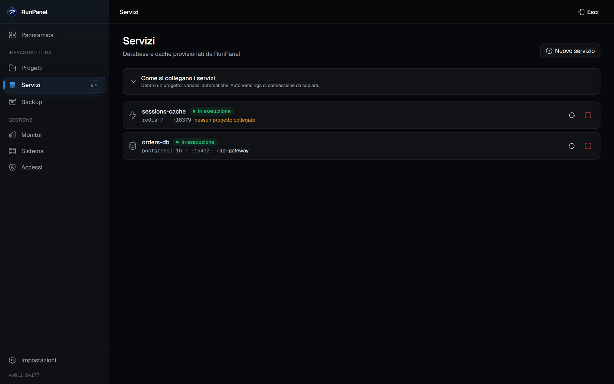
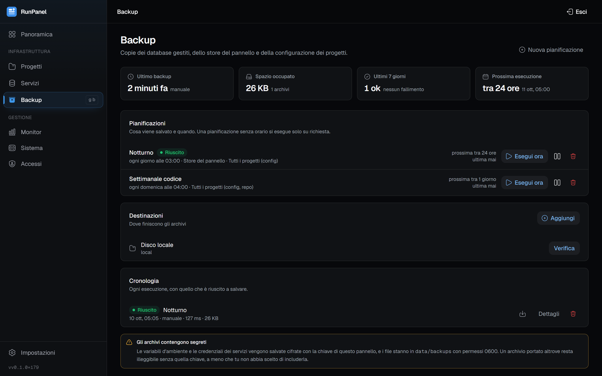
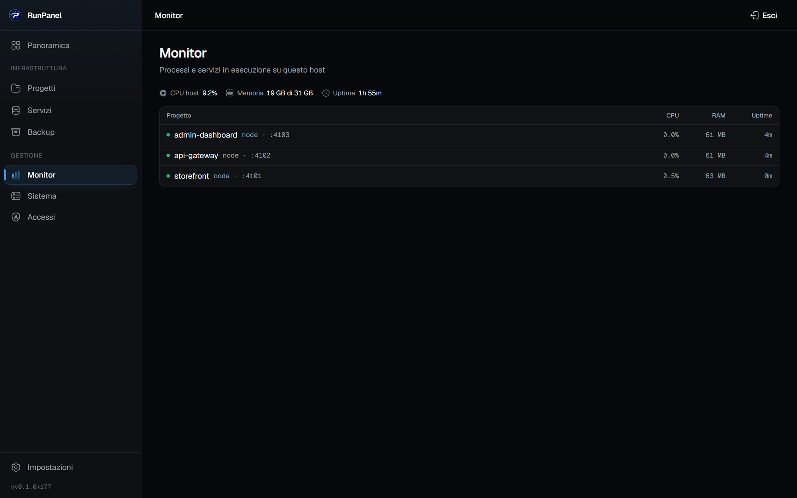
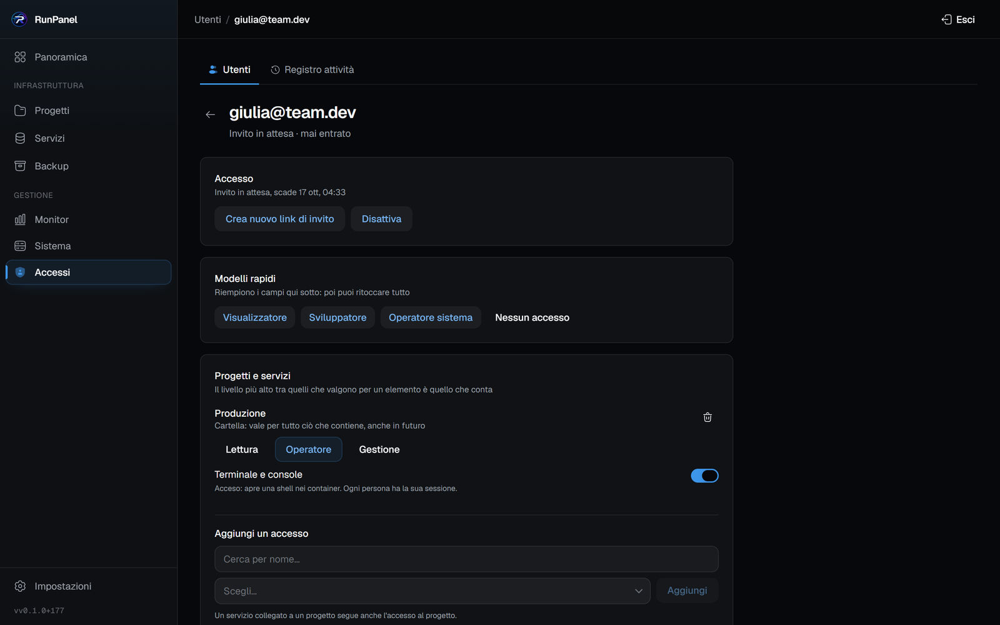

<div align="center">


# RunPanel

**Il tuo server, i tuoi deploy.** Un pannello self-hosted che distribuisce da GitHub, da uno ZIP
o da un Dockerfile, con il build in diretta, database su richiesta e backup che si ripristinano davvero.

**Italiano** · [English](README.md)

[](https://nextjs.org) [](https://react.dev) [](https://www.typescriptlang.org) [](https://nodejs.org) [](https://www.docker.com) [](https://pm2.keymetrics.io) [](https://sqlite.org) [](https://www.postgresql.org) [](#licenza)

[Avvio rapido](#-avvio-rapido) · [Funzionalità](#-cosa-fa) · [Schermate](#-il-pannello) · [Documentazione](#-documentazione) · [Sicurezza](#-sicurezza)

<br>



</div>

<br>

## ✨ Cosa fa

<table>
<tr>
<td width="50%" valign="top">

### 🚀 Distribuisce qualsiasi cosa
Node.js, siti statici, Docker, Compose, o un runtime personalizzato con i tuoi comandi. Un repository può dichiarare il proprio contratto di deploy in `runpanel.json`.

</td>
<td width="50%" valign="top">

### 📡 Deploy in diretta
L'output del build arriva al browser mentre il deploy gira, su una sola connessione SSE per progetto.

</td>
</tr>
<tr>
<td valign="top">

### ⏪ Torna a una versione precedente
Scegli un commit qualsiasi dalla cronologia del branch e distribuisci quello. Il progetto ci resta fermo, e l'auto-deploy viene sospeso invece di riportarlo avanti in silenzio.

</td>
<td valign="top">

### 🗄️ Database su richiesta
PostgreSQL, MySQL, Redis e MongoDB creati come container etichettati con i propri volumi. La connection URL arriva nell'app solo con un interruttore esplicito.

</td>
</tr>
<tr>
<td valign="top">

### 💾 Backup che si ripristinano
Dump programmati dei database, dello store del pannello, della configurazione e dei volumi dei progetti, in un unico zip verificabile, su disco locale o su un bucket S3-compatibile.

</td>
<td valign="top">

### 👥 Utenti e permessi
Più account, inviti con link a scadenza, livelli Lettura / Operatore / Gestione su cartelle, progetti e servizi, e un registro di chi ha fatto cosa.

</td>
</tr>
<tr>
<td valign="top">

### 🔁 Torna su dopo un riavvio
Genera e installa la unit systemd (o una riga cron `@reboot`), controlla che Docker parta all'avvio e rimette su progetti e servizi nell'ordine che hai scelto.

</td>
<td valign="top">

### 🛡️ Porte limitate alle reti che indichi
Qualunque database o app può essere ristretto a indirizzi specifici, con le reti della macchina proposte come caselle da spuntare.

</td>
</tr>
<tr>
<td valign="top">

### 🧹 Manutenzione di Docker
Retention delle immagini per progetto, rilevamento degli orfani e pulizia dei volumi che chiede prima di distruggere dati.

</td>
<td valign="top">

### 🩺 Diagnostica
Una pagina che dice cosa non va in questa installazione e cosa premere per sistemarlo.

</td>
</tr>
<tr>
<td valign="top" colspan="2">

### 🔐 Un sottodominio per progetto
Aggiungi un dominio una volta e dai a ogni progetto `app.tuodominio.it`: il pannello scrive i blocchi per l'nginx che usi già, ottiene e rinnova un certificato Let's Encrypt per ogni nome — anche tramite l'API di Cloudflare, nuvola arancione compresa — e tiene i progetti limitati dietro la stessa lista di indirizzi — senza toccare la tua configurazione di nginx.

</td>
</tr>
<tr>
<td valign="top" colspan="2">

### 🌐 Più server
Collega altre installazioni di RunPanel a questa: stessi account ovunque, progetti, database, backup, monitor, diagnostica e aggiornamenti di ogni server nelle stesse liste, con una scheda per server per carico, disco e avvisi, tutto da un solo pannello — sulla tua rete privata, con richieste firmate e niente esposto su internet.

</td>
</tr>
</table>

## 📺 Deploy in diretta

Premi **Deploy** e il log del build scorre nel browser mentre succede: installazione, build, avvio, health check. Quando il processo risponde, il badge passa a *In esecuzione*.

<div align="center">

</div>

## 💻 Il pannello

<table>
<tr>
<td width="50%" valign="top">

<p align="center"><b>Progetti</b>: stato, runtime, porta e ultimo deploy</p>
</td>
<td width="50%" valign="top">

<p align="center"><b>Dettaglio progetto</b>: risorse, log, deploy, variabili, file</p>
</td>
</tr>
<tr>
<td valign="top">

<p align="center"><b>Servizi</b>: database gestiti e collegamenti ai progetti</p>
</td>
<td valign="top">

<p align="center"><b>Backup</b>: pianificazioni, destinazioni, cronologia</p>
</td>
</tr>
<tr>
<td valign="top">

<p align="center"><b>Monitor</b>: CPU, memoria e uptime di ogni processo</p>
</td>
<td valign="top">

<p align="center"><b>Accessi</b>: livelli per cartella, progetto e servizio</p>
</td>
</tr>
</table>

<details>
<summary><b>Le voci del menu</b></summary>
<br>

Sistema, Accessi e Impostazioni raggruppano più pagine in schede, ognuna con il suo indirizzo.

| Voce | A cosa serve |
|---|---|
| **Panoramica** | stato di tutto, in una schermata: cartelle per raggruppare progetti e servizi, più i servizi senza progetto; con più server, una scheda per server e tutto diviso per server |
| **Progetti** | deploy, log in diretta, storico, variabili, file, terminale, impostazioni |
| **Servizi** | database gestiti, i loro database interni, collegamenti ai progetti |
| **Backup** | policy, destinazioni, esecuzioni, archivi, ripristini |
| **Monitor** | processi e container con CPU, memoria e uptime, più il riepilogo dell'host (di ogni server, se sono più d'uno) |
| **Sistema** | *Diagnostica* (cosa manca e cosa premere), *Avvio automatico* (cosa torna su dopo un riavvio), *Aggiornamenti* (versione, commit nuovi, il pulsante che li applica), *Domini* (i domini serviti da nginx e il sottodominio di ogni progetto), *Pulizia Docker* (cosa occupa il disco e cosa si recupera), *Server* (le installazioni collegate: stato, versione, diagnosi, ruolo, revoca) |
| **Accessi** | *Utenti* (inviti con link a scadenza, permessi per account) e *Registro attività* (chi ha fatto cosa) |
| **Impostazioni** | *Account* (email, password, sessioni, tema chiaro o scuro), *Pannello* (frequenza di refresh, fuso, indirizzo pubblico, intervallo del controllo periodico, colore d'accento, notifiche Telegram, registry privati), *GitHub* (token, repository, branch) |

</details>

<details>
<summary><b>Dettagli che tornano utili</b></summary>
<br>

- **Terminale**: una shell vera sulla cartella del progetto o dentro il suo container, con le sessioni inattive raccolte automaticamente.
- **File**: un browser confinato alla cartella del progetto, che risolve i symlink prima di aprire qualsiasi cosa.
- **Log**: in diretta via SSE mentre il deploy gira, e su file dopo.
- **Sessioni**: una per dispositivo, revocabili singolarmente dall'account.
- **Preferenze**: frequenza di refresh (2, 5, 10 secondi), fuso orario, cinque colori d'accento (blu predefinito), scelti dal proprietario per tutto il pannello.
- **Tema**: chiaro, scuro o quello del sistema, scelto per browser.
- **Palette comandi** e navigazione da tastiera; su mobile una barra in basso e il menu che entra da destra.

</details>

## ⚡ Avvio rapido

| Requisito | |
|---|---|
| **Node.js** | 20 o superiore |
| **Docker** | per i runtime a container, i database creati dal pannello e i loro backup |
| **PM2** | per i progetti con runtime nativo (`node`, `static`, `custom`): `npm i -g pm2` |

```bash
git clone https://github.com/AlessTRV/RunPanel.git
cd RunPanel
npm install
npm run build
npm start
```

Apri `http://localhost:3000`. Alla prima visita crei l'account **proprietario** con email e password, oppure [colleghi questa installazione a un RunPanel che hai già](docs/it/multi-server.md). In entrambi i casi serve il **token di setup** che il pannello scrive nel proprio log all'avvio:

```
[RunPanel] Not set up yet. Enter this token on the setup screen:

    3f9c1a...
```

> [!IMPORTANT]
> Finché non esiste una password quell'endpoint deve restare aperto: il token impedisce a chi trova la porta per primo di prendersi il pannello, e qui un amministratore ha una shell sull'host. A ogni riavvio ne viene emesso uno nuovo, a meno che non lo fissi con `RUNPANEL_SETUP_TOKEN`.

PM2 **non** è incluso: senza, resti sui runtime Docker, e la pagina Diagnostica ti dice cosa manca. Il pannello gira su Linux, macOS e Windows.

## ⚙️ Configurazione

Tutto sta in `.env` (vedi `.env.example` per la versione commentata) ed è controllato all'avvio. Senza, il pannello usa SQLite in `./data` sulla porta 3000 e genera la chiave di cifratura in `data/.secret`: salva quel file insieme ai backup, perché ogni segreto salvato dipende da lui. Variabili, SQLite o Postgres, registry privati e reverse proxy stanno in [Configurazione](docs/it/configuration.md).

## 📚 Documentazione

<table>
<tr>
<td width="33%" valign="top">

**[⚙️ Configurazione](docs/it/configuration.md)**<br>
<sub>Variabili d'ambiente, store SQLite o Postgres, registri privati, metterlo su internet</sub>

</td>
<td width="33%" valign="top">

**[🚀 Distribuire un progetto](docs/it/deploy.md)**<br>
<sub>Sorgenti, runtime e preset, il contratto di deploy e `runpanel.json`, variabili, com'è fatto un deploy</sub>

</td>
<td width="33%" valign="top">

**[🔄 Automazione dei deploy](docs/it/automation.md)**<br>
<sub>Webhook, controllo periodico quando il pannello non è raggiungibile, ritorno a un commit, comandi una tantum</sub>

</td>
</tr>
<tr>
<td valign="top">

**[🗄️ Database e servizi](docs/it/databases.md)**<br>
<sub>Motori gestiti, console, cartelle condivise con l'host, collegamento a un progetto</sub>

</td>
<td valign="top">

**[🛡️ Accesso di rete](docs/it/network.md)**<br>
<sub>Limitare una porta agli indirizzi che indichi</sub>

</td>
<td valign="top">

**[💾 Backup e ripristino](docs/it/backups.md)**<br>
<sub>Cosa si salva, come viene preso, dove finisce, come si rimette a posto</sub>

</td>
</tr>
<tr>
<td valign="top">

**[👥 Utenti e permessi](docs/it/users.md)**<br>
<sub>Account, inviti, livelli su progetti e servizi, permessi del pannello, registro attività</sub>

</td>
<td valign="top">

**[🔧 Operatività](docs/it/operations.md)**<br>
<sub>Avvio automatico, riavvii programmati, liberare spazio, aggiornamento del pannello, notifiche su Telegram</sub>

</td>
<td valign="top">

**[🧭 Architettura e sviluppo](docs/it/architecture.md)**<br>
<sub>Mappa del codice, suite di test, come lavorarci</sub>

</td>
</tr>
<tr>
<td valign="top">

**[🌐 Più server](docs/it/multi-server.md)**<br>
<sub>Collegare i server, ruoli, selettore, account condivisi, diagnostica, revoca</sub>

</td>
<td valign="top">

**[🔐 Domini](docs/it/domains.md)**<br>
<sub>Un sottodominio per progetto sul tuo nginx, certificati HTTPS, la preparazione iniziale</sub>

</td>
</tr>
</table>

## 🔒 Sicurezza

<details open>
<summary><b>Come è protetto il pannello</b></summary>
<br>

- Password con hash bcrypt; le sessioni sono per dispositivo e memorizzate come SHA-256 del cookie, così una copia del database non può essere riusata
- Il setup iniziale richiede il token stampato all'avvio, così un pannello non ancora reclamato non può esserlo da chi arriva per primo
- Il limite sui tentativi di accesso sopravvive a un riavvio, conta in modo atomico, ed è legato a un indirizzo solo dove un proxy configurato lo garantisce
- Più account con permessi per progetto, servizio, cartella e risorsa, controllati dal server su ogni route e su ogni stream; un test fallisce se una route nuova non dichiara cosa protegge ([Utenti e permessi](docs/it/users.md))
- `proxy.ts` rifiuta le richieste `/api` senza sessione prima che arrivino a un handler, in aggiunta al controllo di ciascun handler; le eccezioni sono elencate in [Architettura](docs/it/architecture.md)
- Le chiamate tra server collegati portano un HMAC-SHA256 su metodo, percorso, corpo, utente e orario, con un segreto di cluster cifrato a riposo; ogni firma vale una volta sola, entro cinque minuti ([Più server](docs/it/multi-server.md))
- Variabili dei progetti, credenziali dei servizi, dei registry e dei backup, token GitHub e bot Telegram cifrati a riposo (AES-256-GCM)
- Nessuna variabile `RUNPANEL_*` raggiunge i progetti distribuiti: chiave di cifratura, credenziali dello store e token di setup restano del pannello
- Firme dei webhook verificate con HMAC-SHA256 e confronto a tempo costante
- Le operazioni sui file risolvono i symlink e restano confinate al progetto; gli upload ZIP sono spacchettati in-process, rifiutando voci con traversal e link, con un limite sia sull'archivio sia sul decompresso
- Gli URL dei repository devono essere `https://` pubblici, e il token GitHub è allegato soltanto alle richieste verso GitHub
- I comandi esterni passano sempre da un array di argomenti, mai da una stringa di shell
- Qualunque porta pubblicata può essere limitata a reti indicate, davanti a un ascoltatore spostato su loopback perché non ci sia modo di aggirarla
- Sottodomini: i blocchi nginx nascono da nomi validati due volte, dalla route e dal renderer; certbot gira con l'utente del pannello; a root si arriva solo per `nginx -t` e `nginx -s reload`, tramite path unit systemd che non leggono mai ciò che scrive il pannello; un token Cloudflare è cifrato a riposo e arriva all'hook di certbot solo nell'ambiente di ogni esecuzione ([Domini](docs/it/domains.md))

Per il TLS e i reverse proxy davanti al pannello, vedi [Metterlo su internet](docs/it/configuration.md#metterlo-su-internet).

</details>

## ⚠️ Limiti noti

<details>
<summary><b>Cosa sapere prima di affidargli la produzione</b></summary>
<br>

- I comandi una tantum girano **almeno una volta**, non esattamente una volta: un riavvio del pannello a metà esecuzione rimette il comando in coda.
- Un health check fallito lascia il progetto in errore: **non c'è un ritorno automatico** alla versione precedente.
- Le restrizioni sulle porte le applica il processo del pannello: a pannello fermo la porta semplicemente si chiude. Una regola che deve valere anche a pannello spento richiede in più un firewall sull'host.
- Il **ripristino** non confronta le versioni dei motori, e rifiuta lo store Postgres di RunPanel (il comando `pg_restore` è nel manifest dell'archivio). Vedi [Backup](docs/it/backups.md#ripristino).
- L'installazione automatica all'avvio è **solo per Linux**; altrove il pannello mostra cosa fare a mano.
- Le **notifiche** hanno un solo canale, Telegram, e vanno in una sola chat. Il bot non accetta comandi.
- I **più server** hanno bisogno di una rete privata e cifrata tra loro (Tailscale, per esempio) o di HTTPS, e un server si collega solo al primo avvio. Vedi [Più server](docs/it/multi-server.md#limiti).
- L'**aggiornamento del pannello dal pannello** richiede un supervisore che lo rimetta su dopo l'uscita (systemd o lo script `@reboot`); senza, scambio e riavvio restano due comandi da dare a mano. Non è disponibile in un container né su Windows.

</details>

<br>

<div align="center">

## Licenza

MIT

<sub>[⬆ Torna su](#runpanel)</sub>

</div>
