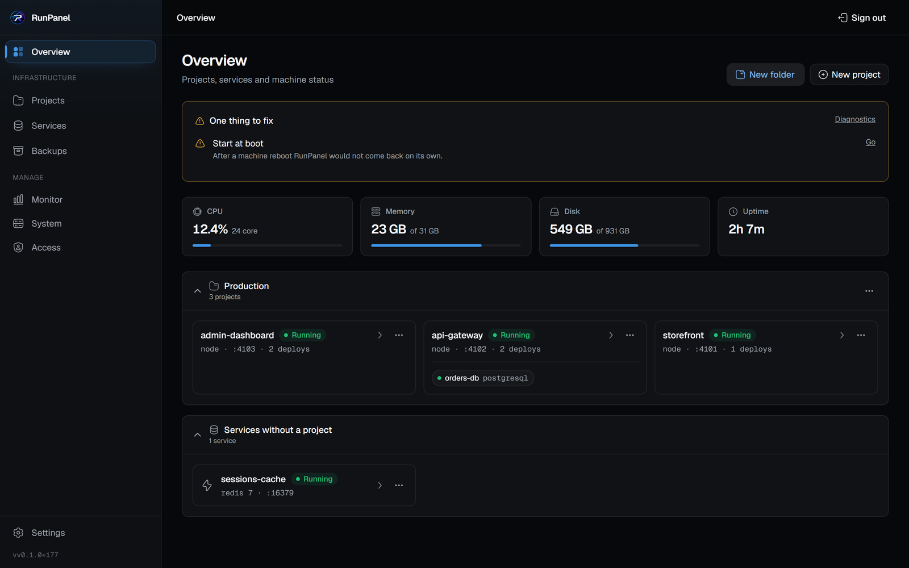
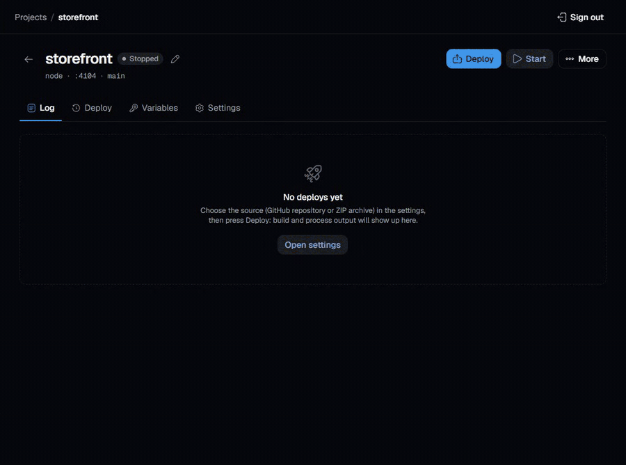
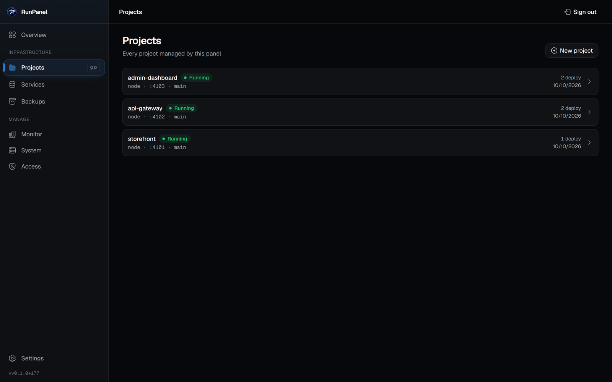
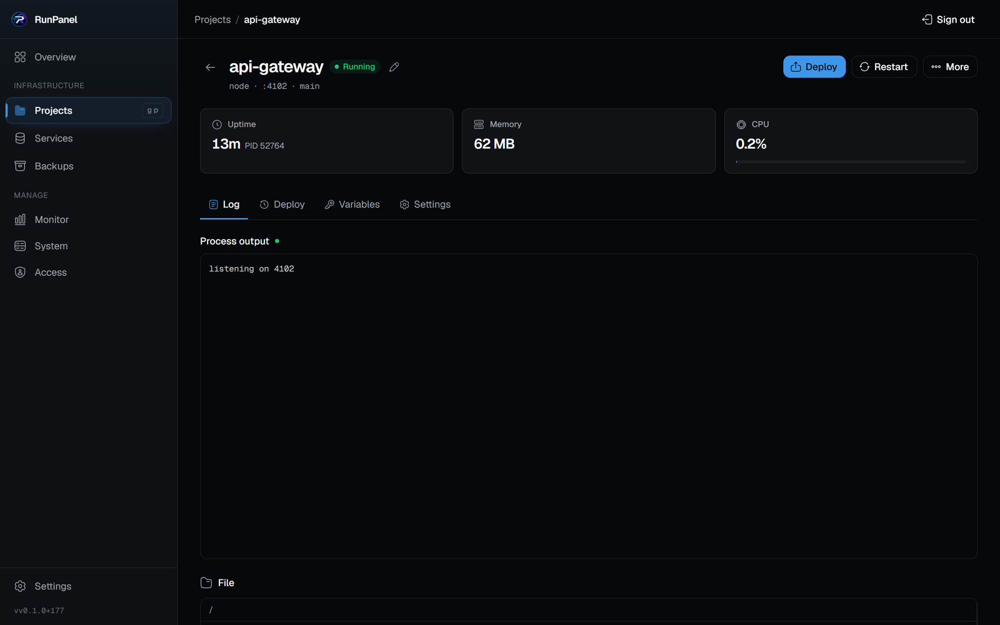
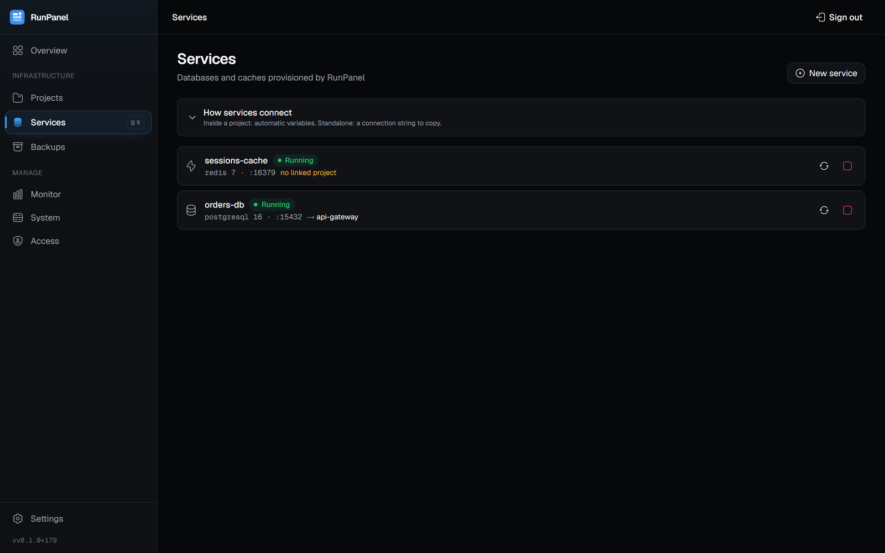
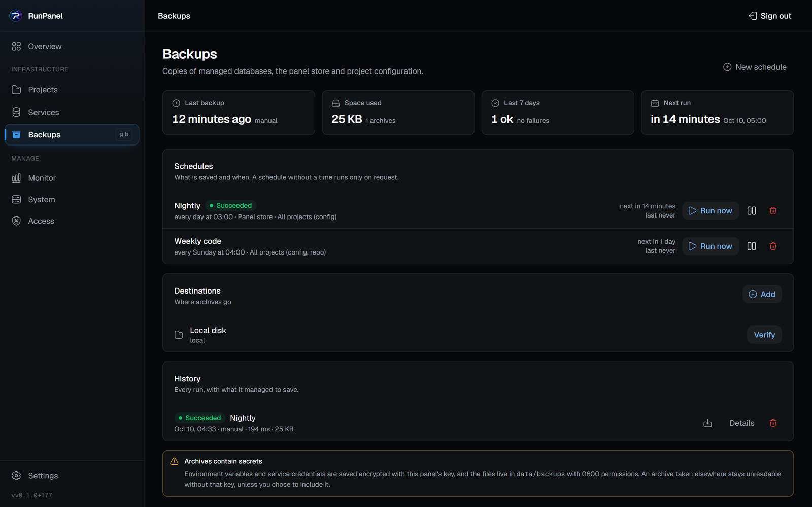
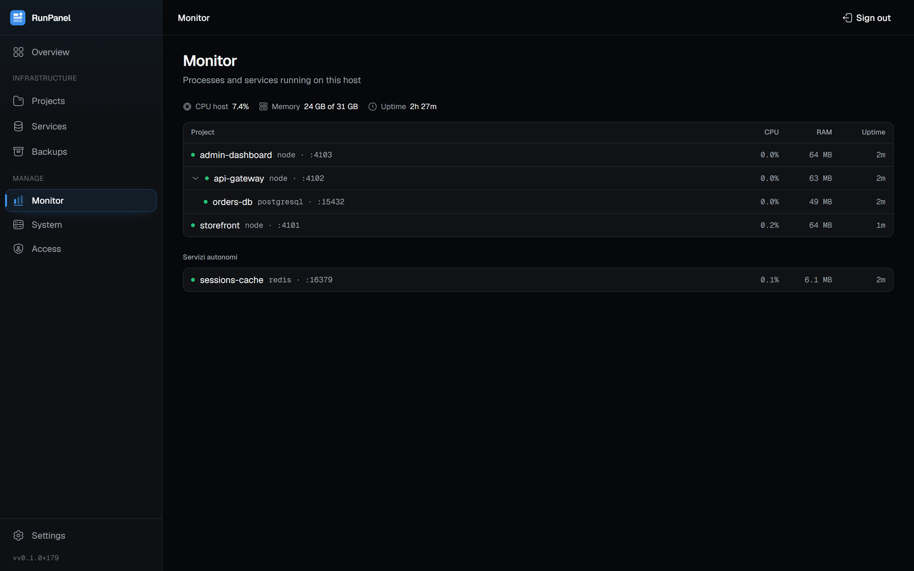
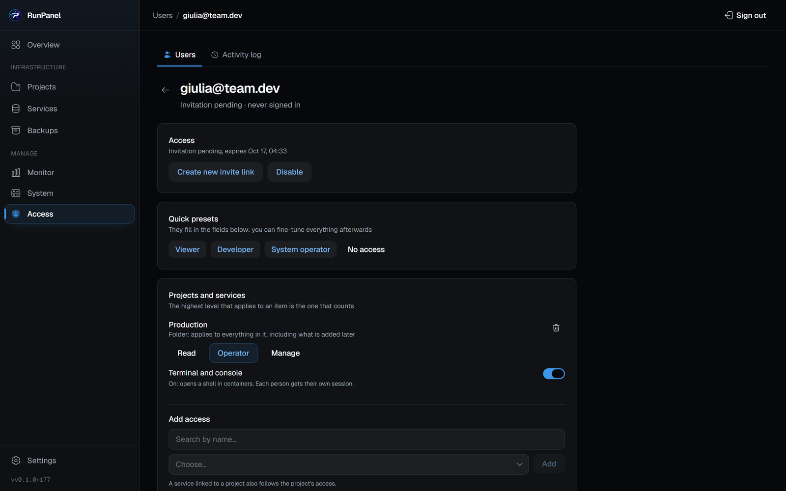

<div align="center">


# RunPanel

**Your server, your deploys.** A self-hosted panel that deploys from GitHub, a ZIP or a Dockerfile,
with live build output, databases on demand and backups that actually restore.

[Italiano](README.it.md) · **English**

[](https://nextjs.org) [](https://react.dev) [](https://www.typescriptlang.org) [](https://nodejs.org) [](https://www.docker.com) [](https://pm2.keymetrics.io) [](https://sqlite.org) [](https://www.postgresql.org) [](#license)

[Quick start](#-quick-start) · [Features](#-what-it-does) · [Screenshots](#-the-panel) · [Documentation](#-documentation) · [Security](#-security)

<br>



</div>

<br>

## ✨ What it does

<table>
<tr>
<td width="50%" valign="top">

### 🚀 Deploys anything
Node.js, static sites, Docker, Compose, or a custom runtime with your own commands. A repository can describe its own deploy contract in `runpanel.json`.

</td>
<td width="50%" valign="top">

### 📡 Live deploys
Build output streams to the browser while the deploy runs, over a single SSE connection per project.

</td>
</tr>
<tr>
<td valign="top">

### ⏪ Go back a version
Pick any commit from the branch's history and deploy it. The project holds there, and auto-deploy is suspended rather than quietly carrying it forward again.

</td>
<td valign="top">

### 🗄️ Databases on demand
PostgreSQL, MySQL, Redis and MongoDB provisioned as labelled containers with their own volumes. The connection URL reaches the app only through an explicit switch.

</td>
</tr>
<tr>
<td valign="top">

### 💾 Backups that restore
Scheduled dumps of the databases, of the panel's own store, and of project configuration and volumes, into a single verifiable zip, on local disk or an S3-compatible bucket.

</td>
<td valign="top">

### 👥 Users and permissions
Several accounts, invitations with expiring links, Read / Operator / Manage levels on folders, projects and services, and a log of who did what.

</td>
</tr>
<tr>
<td valign="top">

### 🔁 Comes back after a reboot
Generates and installs the systemd unit (or a cron `@reboot` line), checks that Docker starts at boot, and brings back projects and services in the order you chose.

</td>
<td valign="top">

### 🛡️ Ports limited to the networks you name
Any database or app can be restricted to specific addresses, with the machine's own networks offered as tick boxes.

</td>
</tr>
<tr>
<td valign="top">

### 🧹 Docker housekeeping
Image retention per project, orphan detection, and volume cleanup that asks before destroying data.

</td>
<td valign="top">

### 🩺 Diagnostics
One page that says what is wrong with this installation and what to press to fix it.

</td>
</tr>
<tr>
<td valign="top" colspan="2">

### 🌐 More than one server
Link other RunPanel installs to this one: the same accounts everywhere, a server selector in the bar, deploys with their live log, databases, backups and updates of every server from one panel — over your private network, with signed requests and nothing exposed to the internet.

</td>
</tr>
</table>

## 📺 Live deploys

Press **Deploy** and the build log scrolls in the browser as it happens: install, build, start, health check. When the process answers, the badge turns to *Running*.

<div align="center">

</div>

## 💻 The panel

> [!NOTE]
> The screenshots on this page are translated to English; the panel itself ships with an Italian interface.

<table>
<tr>
<td width="50%" valign="top">

<p align="center"><b>Projects</b>: status, runtime, port and last deploy</p>
</td>
<td width="50%" valign="top">

<p align="center"><b>Project detail</b>: resources, logs, deploys, variables, files</p>
</td>
</tr>
<tr>
<td valign="top">

<p align="center"><b>Services</b>: managed databases and project links</p>
</td>
<td valign="top">

<p align="center"><b>Backups</b>: schedules, destinations, history</p>
</td>
</tr>
<tr>
<td valign="top">

<p align="center"><b>Monitor</b>: CPU, memory and uptime of every process</p>
</td>
<td valign="top">

<p align="center"><b>Access</b>: levels per folder, project and service</p>
</td>
</tr>
</table>

<details>
<summary><b>The menu entries</b></summary>
<br>

System, Access and Settings group several pages as tabs, each with its own address.

| Entry | What it is for |
|---|---|
| **Overview** | the state of everything, on one screen: folders to group projects and services, plus the services that belong to no project |
| **Projects** | deploys, live logs, history, variables, files, terminal, settings |
| **Services** | managed databases, the databases inside them, project links |
| **Backups** | policies, destinations, runs, archives, restores |
| **Monitor** | processes and containers with CPU, memory and uptime, plus a summary of the host |
| **System** | *Diagnostics* (what is missing and what to press), *Autostart* (what comes back after a reboot), *Updates* (version, waiting commits, the button that applies them), *Docker cleanup* (what is using the disk and what can be reclaimed), *Servers* (the linked installs: status, version, diagnosis, role, revocation) |
| **Access** | *Users* (invitations with expiring links, per-account permissions) and *Activity log* (who did what) |
| **Settings** | *Account* (email, password, sessions, light or dark theme), *Panel* (refresh rate, timezone, public address, polling interval, accent colour, Telegram notifications, private registries), *GitHub* (token, repositories, branches) |

</details>

<details>
<summary><b>Details worth knowing</b></summary>
<br>

- **Terminal**: a real shell on the project directory or inside its container, with idle sessions reaped automatically.
- **Files**: a browser confined to the project directory, resolving symlinks before opening anything.
- **Logs**: live over SSE while the deploy runs, and on file afterwards.
- **Sessions**: one per device, revocable individually from the account page.
- **Preferences**: refresh rate (2, 5, 10 seconds), timezone, five accent colours (blue by default), set by the owner for the whole panel.
- **Theme**: light, dark or the system's, chosen per browser.
- **Command palette** and keyboard navigation; on mobile a bottom bar and a drawer that comes in from the right.

</details>

## ⚡ Quick start

| Requirement | |
|---|---|
| **Node.js** | 20 or newer |
| **Docker** | for container runtimes, provisioned databases and their backups |
| **PM2** | for projects with a native runtime (`node`, `static`, `custom`): `npm i -g pm2` |

```bash
git clone https://github.com/AlessTRV/RunPanel.git
cd RunPanel
npm install
npm run build
npm start
```

Open `http://localhost:3000`. The first visit either creates the **owner** account with an email and a password, or [links this install to a RunPanel you already have](docs/en/multi-server.md). Both need the **setup token** the panel prints to its own log at startup:

```
[RunPanel] Not set up yet. Enter this token on the setup screen:

    3f9c1a...
```

> [!IMPORTANT]
> Until a password exists, that endpoint has to be open: the token is what stops whoever finds the port first from claiming the panel, and an admin here has a shell on the host. A restart issues a new one, unless you pin it with `RUNPANEL_SETUP_TOKEN`.

PM2 is **not** vendored: without it you keep to the Docker runtimes, and the Diagnostics page tells you what is missing. The panel runs on Linux, macOS and Windows.

## ⚙️ Configuration

Everything lives in `.env` (see `.env.example` for the annotated version) and is checked at boot. Without one the panel runs with SQLite in `./data` on port 3000, and generates its encryption key in `data/.secret`: keep that file with your backups, because every stored secret depends on it. Variables, SQLite or Postgres, private registries and reverse proxies are in [Configuration](docs/en/configuration.md).

## 📚 Documentation

<table>
<tr>
<td width="33%" valign="top">

**[⚙️ Configuration](docs/en/configuration.md)**<br>
<sub>Environment variables, SQLite or Postgres store, private registries, putting it on the internet</sub>

</td>
<td width="33%" valign="top">

**[🚀 Deploying a project](docs/en/deploy.md)**<br>
<sub>Sources, runtimes and presets, the deploy contract and `runpanel.json`, variables, what a deploy actually does</sub>

</td>
<td width="33%" valign="top">

**[🔄 Deploy automation](docs/en/automation.md)**<br>
<sub>Webhooks, polling for a panel nothing can reach, going back to a commit, one-time commands</sub>

</td>
</tr>
<tr>
<td valign="top">

**[🗄️ Databases and services](docs/en/databases.md)**<br>
<sub>Managed engines, console, folders shared with the host, linking one to a project</sub>

</td>
<td valign="top">

**[🛡️ Network access](docs/en/network.md)**<br>
<sub>Restricting a port to the addresses you name</sub>

</td>
<td valign="top">

**[💾 Backups and restore](docs/en/backups.md)**<br>
<sub>What is saved, how it is taken, where it goes, how it comes back</sub>

</td>
</tr>
<tr>
<td valign="top">

**[👥 Users and permissions](docs/en/users.md)**<br>
<sub>Accounts, invitations, levels on projects and services, panel permissions, activity log</sub>

</td>
<td valign="top">

**[🔧 Operations](docs/en/operations.md)**<br>
<sub>Starting at boot, scheduled restarts, freeing space, updating the panel, Telegram notifications</sub>

</td>
<td valign="top">

**[🧭 Architecture and development](docs/en/architecture.md)**<br>
<sub>Map of the code, the test suite, working on it</sub>

</td>
</tr>
<tr>
<td valign="top">

**[🌐 More than one server](docs/en/multi-server.md)**<br>
<sub>Linking servers, roles, the selector, shared accounts, diagnosis, revocation</sub>

</td>
</tr>
</table>

## 🔒 Security

<details open>
<summary><b>How the panel is protected</b></summary>
<br>

- Passwords hashed with bcrypt; sessions are per device and stored as a SHA-256 of the cookie, so a database copy cannot be replayed
- First-run setup requires the token printed at boot, so an unclaimed panel cannot be claimed by whoever arrives first
- Login rate limiting survives a restart, counts atomically, and is keyed on an address only where a configured proxy vouches for it
- Several accounts with permissions per project, service, folder and resource, checked by the server on every route and every stream; a test fails when a new route does not declare what it protects ([Users and permissions](docs/en/users.md))
- `proxy.ts` refuses `/api` requests without a session before they reach a handler, in addition to each handler's own check; the exceptions are listed in [Architecture](docs/en/architecture.md)
- Calls between linked servers carry an HMAC-SHA256 over method, path, body, user and time, keyed with a cluster secret encrypted at rest; each signature is accepted once, within five minutes ([More than one server](docs/en/multi-server.md))
- Project variables, service credentials, registry and backup credentials, the GitHub token and the Telegram bot encrypted at rest (AES-256-GCM)
- No `RUNPANEL_*` variable reaches deployed projects: the encryption key, the store's credentials and the setup token stay with the panel
- Webhook signatures verified with HMAC-SHA256 and a constant-time compare
- File operations resolve symlinks and are confined to the project; ZIP uploads are unpacked in-process, refusing traversal entries and links, capped by both archive and decompressed size
- Repository URLs must be public `https://`, and the GitHub token is only ever attached to requests to GitHub
- External commands always go through an argv array, never a shell string
- Any published port can be restricted to named networks, in front of a listener that is moved to loopback so there is no way around it

For TLS and reverse proxies in front of the panel, see [Putting it on the internet](docs/en/configuration.md#putting-it-on-the-internet).

</details>

## ⚠️ Known gaps

<details>
<summary><b>What to know before trusting it with production</b></summary>
<br>

- One-time commands run **at least once**, not exactly once: a panel restart mid-execution puts the command back in the queue.
- A failed health check leaves the project in error: there is **no automatic rollback** to the previous version.
- Port restrictions are enforced by the panel process: with the panel stopped the port simply closes. A rule that has to hold with the panel down needs a host firewall as well.
- **Restore** does not compare engine versions, and refuses RunPanel's own Postgres store (the `pg_restore` command is in the archive's manifest). See [Backups](docs/en/backups.md#restore).
- Installing at boot is **Linux-only**; elsewhere the panel shows what to do by hand.
- **Notifications** have one channel, Telegram, and go to one chat. The bot takes no commands.
- **Several servers** need a private, encrypted network between them (Tailscale, for instance) or HTTPS, and a server can only join on its first run. See [More than one server](docs/en/multi-server.md#limits).
- **Updating the panel from the panel** needs a supervisor that starts it again after it exits (systemd or the `@reboot` script); without one the swap and the restart are two commands to run by hand. It is not available in a container or on Windows.

</details>

<br>

<div align="center">

## License

MIT

<sub>[⬆ Back to top](#runpanel)</sub>

</div>
